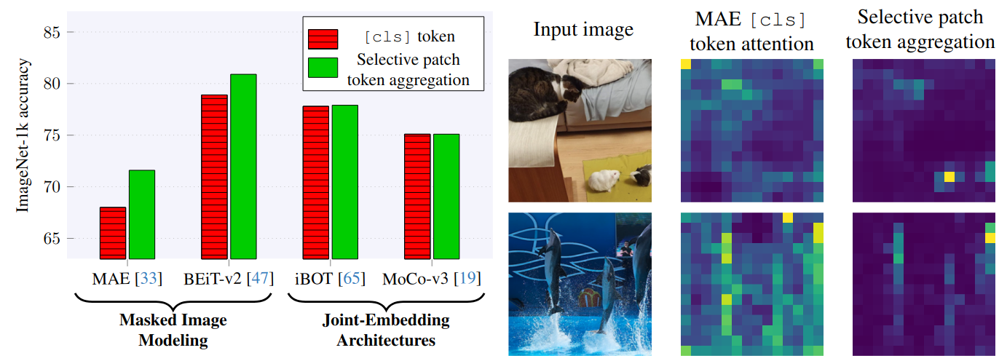

# [Beyond `[cls]`: Exploring the true potential of Masked Image Modeling representations](https://arxiv.org/abs/2412.03215)

**TL;DR:** We show that the attention mechanism of Vision Transformers trained with Masked Image Modeling causes them to form poor high-level representations, and better representations can be achieved via selective aggregation.

<p align="center">

</p>

## Overview

Masked Image Modeling (MIM) has emerged as a promising approach for Self-Supervised Learning (SSL) of visual representations. 
However, the out-of-the-box performance of MIMs is typically inferior to competing approaches. 
Most users cannot afford fine-tuning due to the need for large amounts of data, high GPU consumption, and specialized user knowledge. 
Therefore, the practical use of MIM representations is limited. In this paper we ask what is the reason for the poor out-of-the-box performance of MIMs. 
Is it due to weaker features produced by MIM models, or is it due to suboptimal usage? 
Through detailed analysis, we show that attention in MIMs is spread almost uniformly over many patches, leading to ineffective aggregation by the [cls] token. 
Based on this insight, we propose Selective aggregation to better capture the rich semantic information retained in patch tokens, which significantly improves the out-of-the-box performance of MIM.

These scripts are based on the [official MAE codebase](https://github.com/facebookresearch/mae).


## Running the code

Dependencies are listed in `requirements.txt`.


Evaluating  MAE ViT-B + AbMILP on ImageNet-1k classification:
```
torchrun --nproc_per_node 4 --nnodes 1 --rdzv-id=$RDZV_ID --rdzv-endpoint=$HOST:$PORT --rdzv-backend=c10d \
    main_linprobe.py --amp bfloat16  --num_workers 16  --dataloader_affinity_hack \
        --epochs 90 --accum_iter 2 --optimizer lars --batch_size 2048 \
        --model vit_base_patch16 --finetune vit_base_patch16_224.mae \
        --data_path $IMAGENET_PATH --output_dir $OUT_DIR  \
        --cls_features abmilp  --abmilp_act relu --abmilp_sa none \
        --abmilp_depth 1 --abmilp_cond none --abmilp_content patch 
         
```

Calculating the attention statistics of the MAE (WANDB required):
```
export WANDB_API_KEY=...
export WANDB_PROJECT=...
export WANDB_ENTITY=...

python main_attention_stats.py --batch_size 512 --num_workers 16 \
    --model vit_base_patch16 --finetune vit_base_patch16_224.mae --input_size 224 \
    --data_path  $IMAGENET_PATH --output_dir $OUT_DIR
```

The scripts are compatible with three types of ViT encoder checkpoints:
* compatible with MAE implementation 
* compatible with SimMIM implementation (add `--simmim` flag to the scripts)
* MAE-compatible checkpoints listed in the [timm](https://github.com/huggingface/pytorch-image-models/blob/main/timm/models/vision_transformer.py) library

In the case of the first two, a path to the checkpoint should be provided with the `--finetune` argument. 
If the value of this argument is not a valid path, the script will look for this checkpoint in the `timm` library.

## Acknowledgments

This codebase is based on the fragments of the official [MAE](https://github.com/facebookresearch/mae), and [SimMIM](https://github.com/microsoft/SimMIM/tree/main) implementations.
We thank the authors for open-sourcing them.

## Citation

If you find our work interesting, please cite it:

```
@InProceedings{Przewiezlikowski_2025_ICCV,
    author    = {Przewi\k{e}\'zlikowski, Marcin and Balestriero, Randall and Jasi\'nski, Wojciech and \'Smieja, Marek and Zieli\'nski, Bartosz},
    title     = {Beyond [cls]: Exploring the True Potential of Masked Image Modeling Representations},
    booktitle = {Proceedings of the IEEE/CVF International Conference on Computer Vision (ICCV)},
    month     = {October},
    year      = {2025},
    pages     = {23442-23452}
}
```
